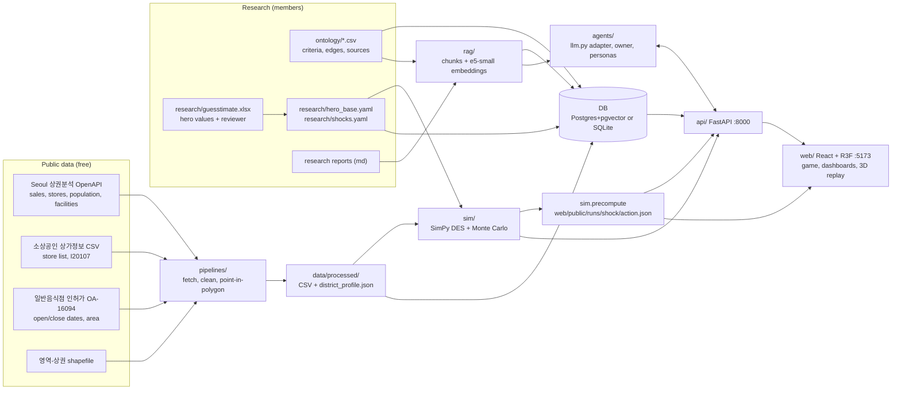

# Architecture

A store-level digital twin of a composite, independent 삼겹살집 in 대학로(혜화역), 상권 3120012. Public data and
sourced guesstimates fill a driver-tree ontology; a discrete-event simulation turns it into a living store;
the UI plays it as a management game (pick a shock, pick the owner's response, watch the night replay); LLM
personas give the store a voice. Every layer reads the same ontology, so a new 업종 is a config change.

**All store-level numbers are illustrative seed guesstimates until a named member reviews them**
(`research/guesstimate.xlsx`, column `reviewed_by`).

## 1. System map

## 2. Layers

| Layer | Folder | What it does | Owner role |
|---|---|---|---|
| L0 Ontology | `ontology/` | 100 criteria (nodes) in a revenue/profit driver tree, 139 causal edges with sign and mechanism, 76 sources. `method` per node: public, guesstimate, interview_later, derived | Ontology owner |
| L1 Evidence | `pipelines/`, `research/`, `data/processed/` | Public data pulls by 업종 code (see `docs/DATA.md`); guesstimates with low/base/high, reasoning, source, confidence, reviewer | Research A/B |
| L2 Store twin | `research/hero_base.yaml` | One composite hero store with every criterion filled; the 27 real I20107 stores carry public attributes only | Research B |
| L3 Simulation | `sim/` | SimPy night model (arrivals, segments, queue, balking, tables, dwell, orders, staff), Monte Carlo p10/p50/p90, shocks, owner actions, event log (see `docs/SIMULATION.md`, `docs/EVENT_LOG.md`) | Simulation |
| L4 Agents + RAG | `agents/`, `rag/` | Owner agent picks one action from the sim's menu; persona chat grounded in retrieved documents | Architecture |
| Data + API | `db/`, `api/` | One schema for Postgres+pgvector and SQLite; idempotent loader; FastAPI | Architecture |
| L6 UI | `web/` | Game flow, dashboards, 3D first-person replay of the simulated night | UI/3D |

## 3. Data flow: public data to 3D replay

1. **Fetch.** `python -m pipelines.run_all` reads `industry/pork_bbq.yaml` (업종 codes, 상권, quarters) and pulls
   the Seoul 상권 tables, the 소상공인 store list and the 종로구 인허가 records. Raw pages are cached in `data/raw/`.
2. **Locate.** Store points (WGS84) and license points (EPSG:5174, plus address backfill) are converted to
   EPSG:5181 and assigned to 상권 polygons. Licenses are matched to stores by address, fuzzy name and distance.
3. **Profile.** `district_profile.json` holds per-quarter 한식 sales, stores, time-band / day / age shares,
   population and facilities, plus Kaplan-Meier survival tables: the study 상권, and (with
   `survival_scope: wide`) a wider label sample of all 종로구 plus 신촌역 3120094 comparing pork-grill
   licenses with all 한식 (`docs/DATA.md` section 4).
4. **Fill the twin.** `research/build_workbook.py` seeds the workbook and exports `hero_base.yaml` and
   `shocks.yaml`. Members review values in Excel; `reviewed_by` travels into the DB.
5. **Simulate.** `sim/` reads the hero parameters and the district time-band shares, runs base, shocked and
   reacted months (common random numbers), and logs one Saturday night of events.
6. **Precompute.** `python -m sim.precompute` writes `web/public/runs/<shock>/<action>.json` plus `index.json`,
   so the game is instant and works offline.
7. **Serve.** `python -m db.load` and `python -m rag.ingest` fill the DB; FastAPI serves the ontology, district,
   hero, runs, live simulation, owner decisions and chat.
8. **Play.** The web app shows a shock card, the owner's options with their p50 outcomes, the chosen outcome,
   and replays the logged night in 3D (base vs shocked) from the event log.

## 4. Database

`db/models.py` (SQLAlchemy) is the single definition; `db/schema.sql` is generated from it for Postgres
(`python -m db.schema_sql`, a test keeps them identical). `DATABASE_URL` picks Postgres+pgvector (compose) or a
local SQLite file (default `data/twin.db`). Natural keys everywhere, so every load is an upsert.

| Table | One row per | Key | Loaded from |
|---|---|---|---|
| `industry` | 업종 config | industry_id | `industry/*.yaml`, profile meta + survival tables |
| `source` | evidence source | source_id | `ontology/sources.csv` |
| `criterion` | ontology node | criterion_id | `ontology/criteria.csv` |
| `criterion_edge` | causal link | from_id, to_id | `ontology/edges.csv` |
| `hero_attribute` | hero value (low/base/high, method incl. derived, source, confidence, filled_by, reviewed_by) | industry_id, criterion_id | `research/hero_base.yaml` + workbook HeroStore sheet |
| `scenario` | base case | scenario_id | `_pnl_base` in hero_base.yaml (the workbook P&L, a calibration target; the game's baseline month is `sim.season.baseline_month`, see `docs/SIMULATION.md`) |
| `shock` | shock definition | shock_id | `research/shocks.yaml` |
| `district` | 상권 | trdar_code | `seoul_trdar.csv`, GeoJSON, profile |
| `district_quarter` | 상권 × quarter | trdar_code, quarter | `district_profile.json` |
| `store` | public store (I201*) | store_id | `stores_sbiz.csv` + best license match |
| `store_license` | 인허가 record (survival label) | license_id | `licenses.csv` |
| `doc_chunk` | RAG chunk + embedding (vector(384) or JSON) | chunk_id | `rag/ingest.py` |
| `sim_run` | API-triggered simulation | run_id | `POST /simulate` |
| `sim_kpi` | KPI p10/p50/p90 per variant | run_id, variant, kpi | same |
| `sim_event` | replay event | run_id, variant, seq | same |
| `game_session` | v2 season (state + every played month) | season_id | `api/season_store.py` (`POST /season`, `/play`) |

## 5. API

| Method | Path | Returns |
|---|---|---|
| GET | `/health` | DB dialect, LLM backend, RAG chunk count, LLM cache entries |
| GET | `/ontology` | nodes (with hero values) + edges |
| GET | `/sources`, `/shocks` | evidence list, shock catalog |
| GET | `/district?trdar=3120012` | district, 22 quarters, stores, survival tables |
| GET | `/hero` | hero attributes + the workbook P&L (`_pnl_base`) |
| GET | `/runs`, `/runs/{shock}/{action}` | precomputed game runs |
| POST | `/simulate` | `{shock_id, action?, action_args?, runs}`: live run (501 if sim is unavailable) |
| GET | `/simulate/{run_id}/events` | logged night for replay |
| POST | `/owner/decide` | `{shock_id, allow_low_confidence?}`: owner agent picks one menu action with a reason; actions whose benefit rests on a confidence-L mechanism are excluded and listed ("인터뷰로 확인 필요") unless allowed |
| POST | `/chat` | `{persona, message, context:{shock, action}}`: grounded persona answer with source ids |
| POST | `/season` | `{mode: guided\|free\|sandbox, seed?, months?}`: new v2 season (`docs/GAME-V2-SPEC.md` §11); id + state + default plan. `months` 1 to 6 (default 6) makes a short season (1개월 체험) that ends, with `season_end` and its report, after that many months |
| GET | `/season/{id}` | state and every played MonthResult (persisted in `game_session`, survives an API restart) |
| POST | `/season/{id}/preview` | `{plan}`: fast expected effect of a plan |
| POST | `/season/{id}/start_month` | `{plan, events?}`: step 1 of a two-step month (§12.1): the night up to its decision points, each with `owner_prompt` and per option `owner_foresight`; no KPIs |
| POST | `/season/{id}/play` | `{plan, events?, night_choices?, prediction?}`: play one month (one step when no choices are sent); MonthResult with owner line, `decision_lines`, event lines and review texts from the persona layer; the player's guess is scored and summarised in GET `/season/{id}` `predictions` |
| POST | `/persona/{id}/ask` | `{who: owner\|<review id>, question}`: the owner (current season facts, the baseline month as 평균 예상, retrieved evidence) or one reviewer grounded in that party's night; the owner's `citations` carry each source's id and title, listed under the answer |
| GET | `/season/{id}/survey` | 트윈 인터뷰: 15 interview-guide questions answered from state, with answer-sheet rows and the values/sources used |
| POST | `/season/{id}/fork` | `{month_index}` (0-based): sandbox copy standing just before that month, same state and month events, plus `actual` (the plan and night choices played); replaying `actual` reproduces the month exactly. Source untouched |
| GET | `/season/{id}/report` | end-of-season report (§14): summary, improvements top 5 (근거/가정), good decisions, luck months, month table, data limits (검토 N/82); uses `sim.report` when present |
| GET | `/season/{id}/export.csv` | month table, UTF-8 with BOM (Excel opens Korean); `Content-Disposition: attachment` with an ASCII name and RFC 5987 `filename*`, so a plain cross-origin `<a href>` downloads it |
| GET | `/season/{id}/report.html` | printable Korean report (light, self-contained, prints to PDF) |
| POST | `/season/{id}/report/ask` | `{question}`: answer from the season's own rows only, citing [11월 행] / [개선 1]; same number guard |
| GET | `/district/layer` | in-game district layer: 27 pork-grill stores, 혜화동 vs Seoul vs national rent, survival curves |
| GET | `/review/drafts` | AI guesstimate drafts with review counts |
| POST | `/review/drafts/{criterion_id}` | draft one criterion with the configured backend (one LLM call) |

Interactive docs at `http://localhost:8000/docs`. CORS allows the web dev server only (`CORS_ORIGINS`).

## 6. Where AI is used, and where it is not

| Place | What the model does | Why |
|---|---|---|
| RAG (`rag/`) | Local multilingual embedding model (intfloat/multilingual-e5-small, CPU) ranks chunks of a small, team-built corpus (see below) | Every persona answer and owner reason can cite where a claim comes from; free, offline after one download |
| Owner agent (`agents/owner.py`) | Chooses ONE action from `sim/owner_actions.MENU` with bounded arguments and a reason, after seeing each action's simulated outcome | The brief asks for the owner's decision mechanism; the choice is explainable and the numbers still come from the simulation |
| Persona chat (`agents/chat.py`) | Speaks as the owner, three customer segments or a staff member. With a real model the answer is written from the prompt; with the default mock it is an intent-specific Korean template (price, cost, rent, staff, customers, weather, competitor, why, data source, card fees, …) that quotes one relevant sentence from the retrieved evidence with its source id | Makes the twin interviewable; numbers are restricted to hero attributes and the given sim result |
| Persona layer (`agents/persona.py`, v2) | Owner reaction lines per month and per event; short Korean reviews in each segment's voice from the structured reviews (segment, stars, reason codes, wait); answers from a specific reviewer about their own night; the 트윈 인터뷰 survey aligned row by row with `research/interview/answer_sheet_template.csv` | Makes the season interviewable. Mock = template banks with variety; a real model gets one call per `/play` and its text is rejected (template used) if it carries a number that is not in the month's data (`agents/numbers.py`) |
| Guesstimation helper (`agents/guesstimate.py`) | Drafts low/base/high, a one-line reasoning chain and cited source ids for a criterion from the top-k evidence (research reports + source list). Output only to `research/review/ai_drafts.csv`; members fill `reviewed_by` and `accept`; `--apply-reviewed` collects reviewed + accepted rows into `accepted_patch.yaml` (HeroStore column names), which `research/build_workbook.py --apply-patch` writes into the workbook | Visible, reviewable AI use in research; it can never write the workbook or the yaml inputs, and an unreviewed draft never reaches the patch |
| Research and code (development) | AI coding assistants built pipelines and docs | Disclosed; numbers they produced are labelled illustrative |

**What the RAG corpus is.** Not a general knowledge base: it is the team's own sourced material, rebuilt
by `python -m rag.ingest` (92 documents, 391 chunks on 2026-10-03). Persona chat and the owner agent retrieve
only the evidence part (`api.main.EVIDENCE_DOCS`, 84 documents, 234 chunks):

| Part | Documents | Chunks |
|---|---|---|
| Source list, one chunk per source (`ontology/sources.csv`: title, publisher, year, reliability note) | 76 | 76 |
| Research reports (`rag/corpus/`: public-data survey, success-label and cost baselines) | 2 | 32 |
| Team sourcing notes (`research/sourcing_round2.md`, `sourcing_round3.md`, `sourcing_round4_v2.md`, `port_lamb.md`) | 4 | 95 |
| Data and research method docs (`docs/DATA.md`, `docs/RESEARCH.md`) | 2 | 31 |

Setup, task, architecture and event-log pages are indexed too (an unfiltered `rag.retrieve` call sees them) but are
excluded from persona answers. The guesstimation helper retrieves from the research reports and the source
list only.

**Deliberately not AI: the simulation.** Customers, queues, orders and costs are a seeded discrete-event model.
An LLM deciding individual customers would be slow, costly and non-reproducible, and its numbers could not
be audited. The LLM only sits at decision points and in conversation.

## 7. Guardrails

- **One adapter.** Every model call goes through `agents/llm.py`. Default backend is `mock` (a deterministic
  Korean template built from the real numbers), so the demo and all tests run without any model.
- **API-only, one call per request, no batch helpers.** A call needs a request context the API creates.
  Command-line tools (the guesstimation CLI) run the offline mock backend only; a real model drafts one
  criterion per API request.
- **Caps.** Per session (`LLM_SESSION_CAP`, 30) and per minute (`LLM_RATE_PER_MIN`, 6) for real models,
  enforced in code. The offline mock is exempt, so clicking through every preset question never returns 429.
- **Visible mode.** `GET /health` reports `backend`, `rag_chunks` and `cache_entries`; the web hides free-text
  questions while the backend is `mock`, because mock answers are templates (preset questions only).
- **Cache first.** sha256(model + prompt) on disk, checked before the cap and the call.
- **Model check.** `claude_cli` runs Opus only; haiku/sonnet names are refused before any process starts.
- **Isolation.** `claude -p` runs from an empty directory outside every repo with `--safe-mode`,
  `--setting-sources project`, `--strict-mcp-config`, `--tools ""`, no session persistence.
- **Confidence gate.** `/owner/decide` maps each action to the mechanism its benefit depends on
  (`agents/owner.py` `ACTION_MECHANISMS`) and leaves out actions resting on confidence-L mechanisms (e.g. staff
  service minutes with no source) until a member reviews them or the request sets `allow_low_confidence`.
- **Write fence.** The guesstimation helper writes only inside `research/review/`; the workbook and yaml
  inputs are refused in code, and a re-draft with new numbers clears that row's review.
- **Strict outputs.** Owner decisions must be one JSON object with a menu action and in-bound arguments;
  anything else falls back to the rule-based pick (highest p50 operating profit). A test fails if a mock chat
  answer contains a number that is not in the hero attributes, the sim result or the question.
- **Data rules.** Free sources only; no scraping of Naver Place, 캐치테이블 or 테이블링; the Seoul API key is read
  from `.env` and never written to outputs (asserted by the pipeline run).
- **Pre-warm is a plan, not a sender.** `python -m agents.prewarm --dry-run` lists the 20 preset questions ×
  shocks with the exact prompt and cache key `/chat` would use (a test proves byte equality); it refuses to
  run without `--dry-run` and never calls a model. On demo day the preset answers CAN be pre-warmed through the
  real backend (`LLM_BACKEND=claude_cli` on Keonhee's Mac): that is Keonhee's call, done by him one request at
  a time through the UI, so every guardrail still applies. No agent or script runs it.
- **End to end.** `scripts/e2e.sh` (or `make e2e`) starts API + web headless, plays one month and asks the
  owner through the real UI with headless Playwright, asserts the answer came from the API, then stops both
  servers.
- **Tests.** `make test` (`python -m pytest tests sim/tests research/tests -q`): mutation-tested guardrails (disabling the cap, the model
  check, the cwd isolation or the number check makes tests fail).

## 8. Porting to another 업종 (카페, 양고기집)

| Step | 카페 | 양고기집 |
|---|---|---|
| `industry/<x>.yaml` | 소분류 for coffee shops, Seoul service code CS100010 (커피-음료), same 상권 list | the 양고기 소분류, CS100001 (한식) or the matching code, same 상권 |
| Ontology | keep `generic` rows; drop grilling rows; ticket = drink + dessert; add takeout share and laptop dwell | close to bbq: rename meat rows, keep grilling and dwell |
| Research | new hero values and shocks in the workbook, reviewed by a member | same |
| Pipelines, DB, API, RAG, agents | unchanged; rerun `pipelines.run_all`, `db.load`, `rag.ingest` | unchanged |
| Simulation | swap the driver template (no grill time, takeout arrivals) | mostly unchanged |

The process carries over as a checklist: pull public data by code, map criteria onto the driver tree,
guesstimate with sources, calibrate to the 상권 per-store benchmark, check the survival label.

## 9. Run

- Docker: `docker compose up -d --build` (API :8000 with the SQLite DB, RAG index and season cache baked into the
  image, web :5173). Postgres + pgvector: add `-f docker-compose.postgres.yml` (see `docs/SETUP.md`,
  Windows: `docs/WINDOWS-DOCKER.md`).
- No Docker: `scripts/dev.sh` (macOS/Linux/WSL) or `scripts\dev.ps1` (Windows), or `make dev`.

## 한국어 요약

- **무엇인가:** 대학로(혜화역) 상권 3120012 에 있는 가상의 독립 삼겹살집을 디지털 트윈으로 만든 프로젝트입니다. 공공데이터와 출처가 있는 추정치로 매출과 비용의 동인 트리(온톨로지)를 채우고, 이산사건 시뮬레이션으로 매장의 하루를 돌리며, 화면에서는 경영 게임처럼 충격과 사장님의 대응을 고르고 그날 밤을 3D로 다시 봅니다.
- **데이터 흐름:** 공공데이터 수집, 상권 경계 안의 점포와 인허가 연결, 상권 프로필 생성, 워크북에서 히어로 매장 값 확정, 시뮬레이션과 사전 계산, DB 적재와 API 제공, 웹 화면 순서로 이어집니다.
- **DB:** 16개 테이블. 같은 정의로 Docker 에서는 Postgres와 pgvector, 로컬에서는 SQLite 파일을 씁니다.
- **AI를 쓰는 곳:** 근거 문서 검색(RAG), 사장님 에이전트의 대응 선택, 페르소나 대화, 추정치 초안 작성(guesstimation helper). 모든 답변은 출처 id를 붙이고, 숫자는 매장 값과 시뮬레이션 결과에서만 가져옵니다. 추정치 초안은 `research/review/ai_drafts.csv` 에만 쓰이고, 팀원이 검토하고 승인한 행만 워크북 반영 후보가 됩니다.
- **AI를 쓰지 않는 곳:** 시뮬레이션 자체. 손님, 대기, 주문, 비용은 재현 가능한 모델로 계산합니다. 그래야 숫자를 검증할 수 있습니다.
- **안전장치:** 모든 호출은 `agents/llm.py` 한 곳을 거치고, 기본값은 외부 모델을 부르지 않는 mock 입니다. 사장님 에이전트는 근거 신뢰도가 낮은(L) 가정에 기대는 대응을 기본으로 제외하고, 인터뷰로 확인이 필요하다고 표시합니다. 세션당 30회, 1분당 6회 상한, 캐시 우선, Opus 외 모델 거부, 저장소 밖 빈 폴더에서 설정과 도구를 끈 채 실행합니다.
- **다른 업종으로 옮기기:** `industry/<업종>.yaml` 의 코드와 온톨로지의 업종 전용 행, 워크북 값만 바꾸면 됩니다. 파이프라인, DB, API, RAG, 에이전트는 그대로 씁니다.
- **모든 매장 수치는 검토 전 예시 추정치입니다.**
